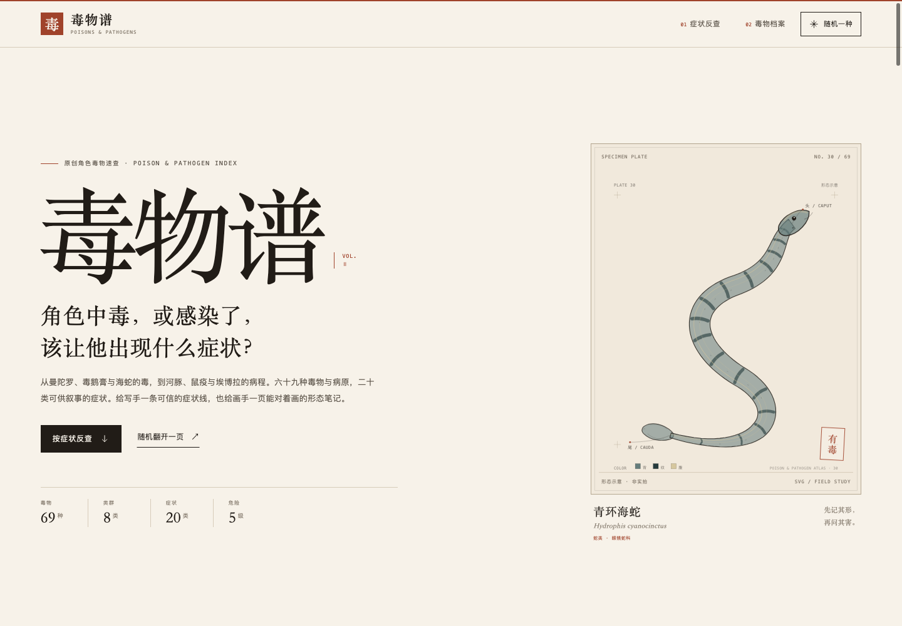
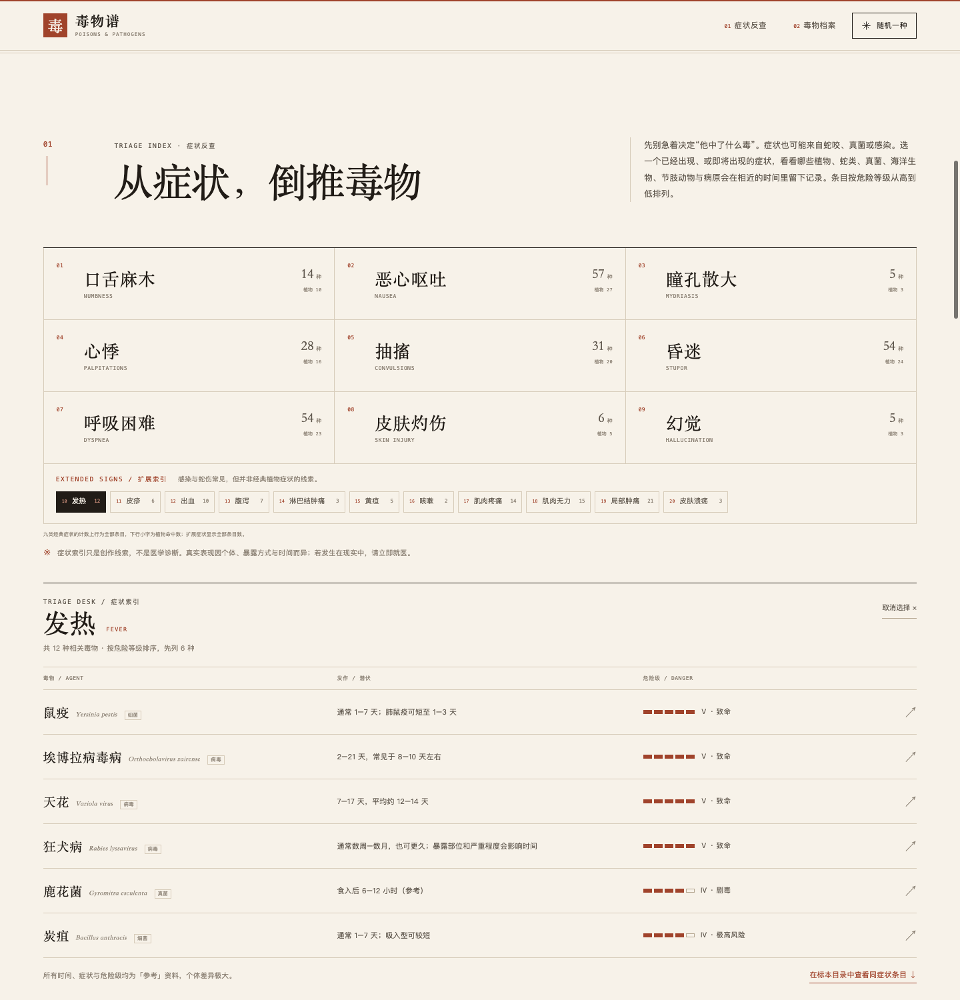
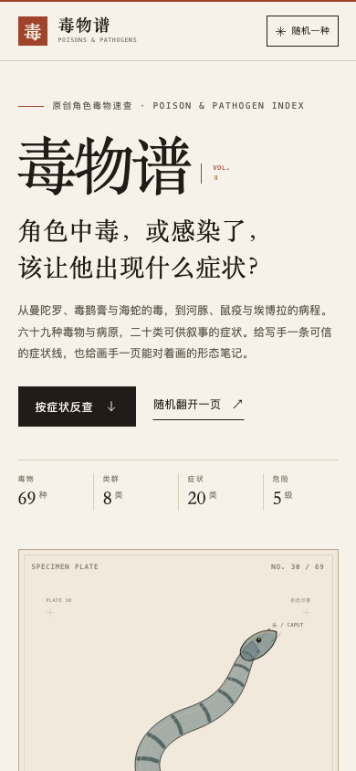
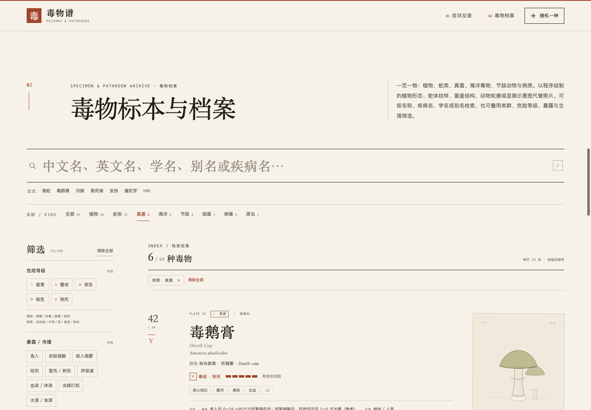
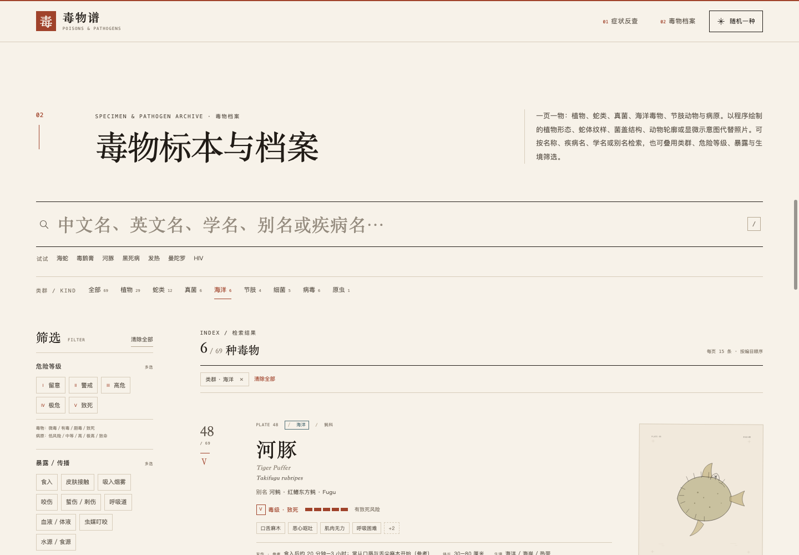
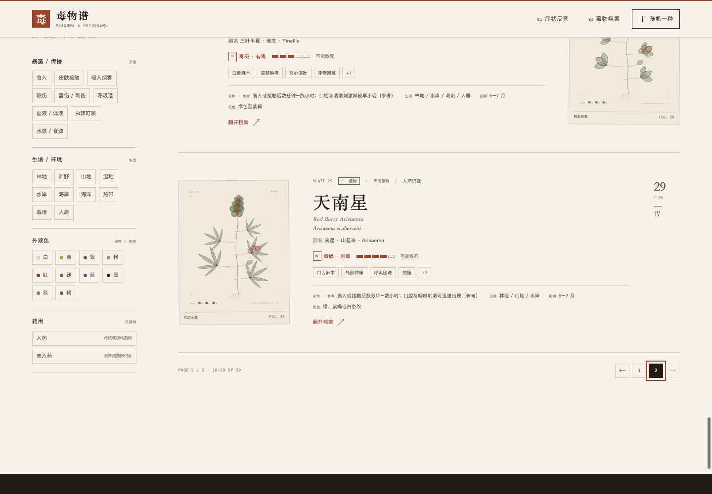
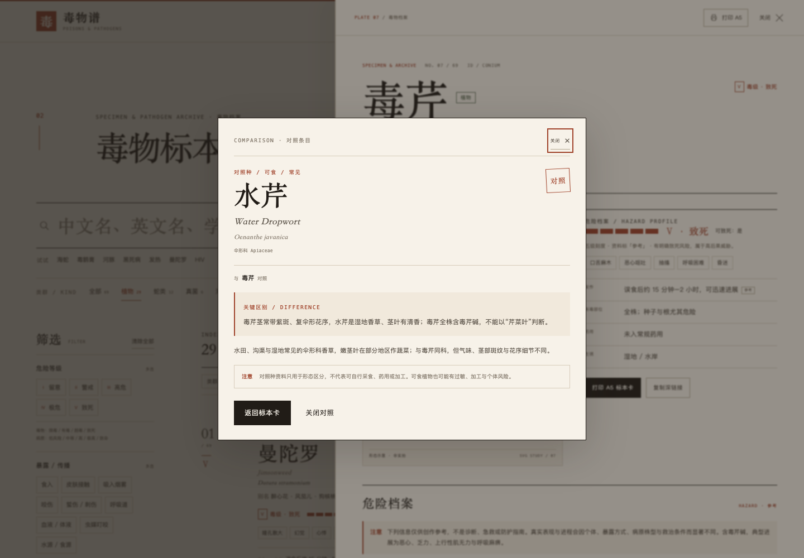
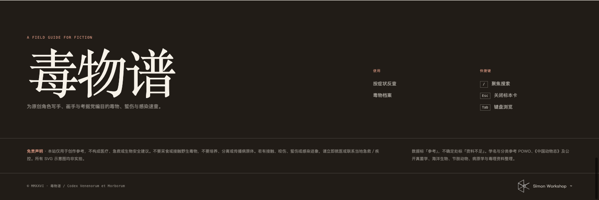
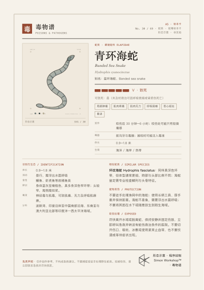
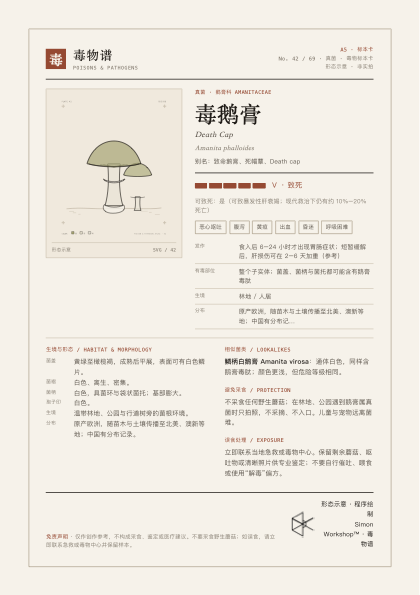

# 毒物谱 · Poisons & Pathogens

为原创角色写手、画手与考据党准备的纯静态毒物与病原速查。签名功能是「按症状反查」：从 20 类症状倒推可能的植物毒、蛇毒、毒蕈、海洋毒物、节肢动物毒或感染，并直接显示时间线索与危险等级。

> 本站仅用于创作参考，不构成医疗、急救或生物安全建议。不要采食或接触野生毒物，不要培养、分离或传播病原体。若有接触、咬伤、蜇伤或感染迹象，请立即就医或联系当地急救／疾控。

## 界面预览

自检截图（Edge headless，本地 `file://` 加载）：







新增的真菌档案：

新增的海洋毒物：

植物档案：

有毒 vs 可食对照：

页脚工坊 logo：

A5 打印稿：

A5 真菌稿：

## 本地预览

直接双击 `index.html` 即可。页面不依赖 `fetch`，使用 `file://` 打开也能完整运行。

若希望以 HTTP 方式预览：

```bash
cd 新项目
python3 -m http.server 8000
# 浏览器打开 http://localhost:8000
```

## GitHub Pages

把仓库根目录（本目录）推到 GitHub，在 **Settings → Pages** 中选择 **Deploy from a branch**、`main` 分支的 `/ (root)` 即可。没有构建步骤，也没有外部依赖。

## 文件

- `index.html`：页面骨架、静态文案与无障碍标记
- `styles.css`：纸张／墨／朱砂视觉系统、响应式布局、抽屉与 A5 打印样式
- `app.js`：程序化示意图、搜索／筛选、症状反查、分类浏览、分页、抽屉、深链接与打印
- `data/plants.js`：站点元数据 + 29 条植物记录（`window.POISON_PLANTS`）
- `data/comparisons.js`：24 个可食／常见对照种 + 29 组植物对照映射
- `data/snakes.js`：12 条蛇类记录，其中 8 种海蛇、4 种陆蛇（`window.POISON_SNAKES`）
- `data/fungi.js`：6 条有毒真菌记录（`window.POISON_FUNGI`）
- `data/marine.js`：6 条海洋毒物记录（`window.POISON_MARINE`）
- `data/arthropods.js`：4 条有毒节肢动物记录（`window.POISON_ARTHROPODS`）
- `data/pathogens.js`：12 条病原记录，含细菌、病毒与原虫（`window.POISON_PATHOGENS`）
- `assets/simon-workshop-logo.png`：Simon Workshop 工坊 logo
- `README.md`：本说明
- `preview/`：自检截图

## 内容与功能

- **69 条毒物／病原**：植物 29、蛇类 12（海蛇 8 + 陆蛇 4）、真菌 6、海洋 6、节肢 4、病原 12（细菌 5 + 病毒 6 + 原虫 1）。
- 植物部分：原有 24 条中已包含你列出的铃兰、秋水仙、海檬树、见血封喉（箭毒木）、毒漆藤、巴豆、雷公藤 7 种；本次补入苦杏仁、木薯、荨麻、半夏、天南星 5 种，因此植物为 **29 条**，没有为了凑 24 删除已有条目。
- 蛇类：青环海蛇、钩鼻海蛇、平颏海蛇、长吻海蛇、环纹海蛇、蓝灰扁尾海蛇、扁尾海蛇、棘眦海蛇；内陆太攀蛇、眼镜王蛇、黑曼巴、锯鳞蝰。
- 真菌：毒鹅膏、毒蝇伞、鳞柄白鹅膏、毒丝膜菌、鹿花菌、裸盖菇。
- 海洋：河豚、地纹芋螺、澳大利亚箱水母、玫瑰毒鲉、大蓝环章鱼、赤魟。
- 节肢：黑寡妇蜘蛛、巴西流浪蜘蛛、以色列金蝎、悉尼漏斗网蛛。
- 病原：鼠疫（黑死病）、炭疽、埃博拉病毒病、艾滋病、流行性感冒、疟疾、霍乱、天花、梅毒、狂犬病、结核病、登革热。
- **20 类症状反查**：9 个经典症状（口舌麻木、恶心呕吐、瞳孔散大、心悸、抽搐、昏迷、呼吸困难、皮肤灼伤、幻觉）+ 11 个扩展症状（发热、皮疹、出血、腹泻、淋巴结肿痛、黄疸、咳嗽、肌肉疼痛、肌肉无力、局部肿痛、皮肤溃疡）。选中后显示对应毒物、发作／潜伏时间与危险级，并同步过滤下方档案。
- 按中文名／英文名／学名／别名／疾病名／症状全文搜索。
- 类群切换（全部／植物／蛇类／真菌／海洋／节肢／细菌／病毒／原虫）；危险等级、暴露／传播、生境／环境、外观色与药用组合筛选。
- 每个植物条目至少有一组「有毒 vs 可食／常见」对照；点击对照卡会打开对应对照条目，写清形态与风险差异。对照种是独立的轻量参考条目，不占 69 条主目录计数，也不会混入主筛选结果。
- 症状索引同时显示全部条目数与植物命中数；九类经典症状均至少有 2 条植物记录。
- 每页 15 条，共 5 页；分页在结果列表下方。
- 详情抽屉、`#hydrophis-cyanocinctus` 这类深链接、浏览器返回关闭、随机一种。
- 快捷键：`/` 聚焦搜索，`Esc` 关闭抽屉或移动端筛选。
- 植物叶花果、蛇体纹样、菌盖／菌褶、海洋动物轮廓、节肢动物与病原显微结构均为程序生成的 SVG，标记「形态示意／结构示意 · 非实拍」。植物剪影统一使用同一套线宽、留白与固定标签位；卡片和抽屉使用同一个毒性印章组件。
- 每类都有配色样本与十六进制色值，供画手参考。
- A5 单页「标本卡」打印；植物、蛇类、真菌、海洋、节肢、病原模板均经无头打印验证（新类别抽查各一页）。
- 390 / 320px 无横向滚动；已验证 1440 / 1024 / 768 / 390 / 320 视口。
- 无障碍：跳转链接、语义标题、表单标签、`aria-pressed` / `aria-expanded`、焦点陷阱、结果 live region。

## 危险刻度的两层语言

站内使用同一套五格危险刻度，但不是正式的毒理或生物安全分级：

| 级别 | 毒物 | 病原 |
| --- | --- | --- |
| Ⅰ | 微毒 | 低风险 |
| Ⅱ | 有毒 | 中等风险 |
| Ⅲ | 有毒 | 高风险 |
| Ⅳ | 剧毒 | 极高风险 |
| Ⅴ | 致死 | 致命 |

植物／蛇毒卡片沿用「微毒／有毒／剧毒／致死」；病原卡片显示「低风险／中等／高／极高／致命」。筛选器使用中性的「留意／警戒／高危／极危／致死」，以便跨类型筛选。现实中的风险取决于暴露剂量、途径、治疗可及性、毒株与个体状况，不能用本站等级替代。

## 数据与安全边界

- 不写剂量、制备、培养、分离、扩增、传播、释放或规避检测的方法。
- 毒性／风险数据统一标「参考」；不确定处使用「资料不足」「资料不一」「仍有讨论」。
- 蛇伤急救仅保留通用原则：尽快就医、保持安静并固定伤肢、不要切开／吸吮／冰敷／使用紧束止血带。
- 真菌部分不提供采食判断、烹饪去毒、剂量或采集加工方法；海洋与节肢部分不提供捕捞、保活、取毒或现场处理方法。
- 病原部分仅描述公开的传播途径、潜伏期与公共卫生要点，不提供任何可操作的生物安全或医疗方案。
- 「是否入药」是植物字段的简化记录；蛇类、真菌、海洋、节肢与病原没有可自行使用的药用建议。
- 这次把植物补到 29 条而不是严格 24 条：因为原 24 条已存在，且你要求已有条目跳过；新增 5 条后无法在不删除旧内容的前提下保持 24。若必须严格 24，需要指定删除哪 5 条。
- 所有时间线、危险等级和致死性均为创作参考，不是临床或正式生物安全结论。

## 仍不确定或需要复核的数据

1. **海蛇分类与中文名**：本站采用当前较常见的学名；钩鼻海蛇（*Hydrophis schistosus*，旧 *Enhydrina schistosa*）、平颏海蛇（*Hydrophis curtus*，旧 *Lapemis curtus*）、长吻海蛇（*Hydrophis platurus*，旧 *Pelamis platurus*）等均有历史异名与中文俗名混用问题。
2. **海蛇咬伤资料**：临床资料主要来自少数常见种，不能把某一种的发作速度和症状直接套到全部海蛇。棘眦海蛇的毒性相对较弱已单独标注，但仍不应接触。
3. **蛇类分布与长度**：不同地区的体型与环带数量差异很大；页面填的是概括区间。蓝灰扁尾海蛇与扁尾海蛇的野外鉴别需要鳞列与头骨特征，不能靠插图。
4. **埃博拉病毒**：已使用当前分类名 *Orthoebolavirus zairense*，旧称 *Zaire ebolavirus*；不同毒株和救治条件下的致死率差异很大。
5. **HIV／艾滋病**：页面把「U=U」处理为简明的公共卫生要点；U=U 需要持续规范治疗且病毒载量检测不到，具体判断属于医疗语境。
6. **天花**：已在 1980 年宣布根除，现无自然传播；页面不涉及任何病毒样本、实验室或获取路径。
7. **炭疽、鼠疫、狂犬病、霍乱、疟疾、梅毒、结核、登革热**：潜伏期、临床分型、疫苗与治疗可及性均可能随地区、毒株／病原株和个体变化。页面中的「是否可致死」是概括，不是预后承诺。
8. **「黑死病」**：是鼠疫的历史大流行称呼，不等同于独立的病原体；本站把两者放在同一条目中。
9. **临床表现与插图**：病原结构图是简化教学示意，并非真实显微照片，不按比例；蛇体纹样也不是鉴定图。
10. **植物部分**：前一轮的条目仍保留相同的「资料不足／参考资料」限制；盆栽、归化与原生分布可能因地区而异。
11. **真菌鉴定**：毒鹅膏、鳞柄白鹅膏与可食蘑菇的野外区分不可靠；鹿花菌与羊肚菌也常被混淆。页面插图为示意，不可用于采食。
12. **真菌毒理**：鹅膏毒肽的死亡比例、奥来宁的潜伏期与鹿花菌素的风险会随救治、剂量与个体差异变化；页面只保留概括区间。
13. **海洋毒物**：河豚毒性随种、组织、季节和个体差异极大；箱水母、芋螺、毒鲉、蓝环章鱼与魟的现场记录多来自特定海域，不能外推到所有近缘种。
14. **节肢动物**：黑寡妇、巴西流浪蜘蛛、金蝎与漏斗网蛛的咬伤严重度差异很大；儿童、老人和基础病患者风险更高，页面不是现场鉴定或急救指南。

## 参考来源（供复核）

- [Amatoxin Mushroom Toxicity — NCBI Bookshelf](https://www.ncbi.nlm.nih.gov/books/NBK431052/)
- [Amanita Species Mushroom Poisonings — CDC MMWR](https://www.cdc.gov/mmwr/volumes/75/wr/mm7520a2.htm)
- [Mushroom Toxicity — NCBI Bookshelf](https://www.ncbi.nlm.nih.gov/books/NBK537111/)
- [Tetrodotoxin Poisoning Outbreak — CDC MMWR](https://www.cdc.gov/mmwr/preview/mmwrhtml/mm6351a2.htm)
- [Venomous Spiders at Work — CDC/NIOSH](https://www.cdc.gov/niosh/outdoor-workers/about/venomous-spiders.html)
- [Irukandji Syndrome — NCBI Bookshelf](https://www.ncbi.nlm.nih.gov/books/NBK562264/)
- [Sea Snake Toxicity — StatPearls, NCBI Bookshelf](https://www.ncbi.nlm.nih.gov/books/NBK532973/)
- [蓝灰扁尾海蛇 — 科普中国](https://www.kepuchina.cn/article/articleinfo?business_type=100&classify=0&ar_id=185590)
- [棘眦海蛇 — 科普中国](https://cloud.kepuchina.cn/newSearch/imgText?id=6969034931761836032)
- [海蛇亚科 — 维基百科](https://zh.wikipedia.org/wiki/海蛇亚科)
- [Plants of the World Online — Kew](https://powo.science.kew.org/)
- [WHO Fact Sheets](https://www.who.int/news-room/fact-sheets)／[CDC](https://www.cdc.gov/)：病原传播、潜伏期与公共卫生要点的通用背景。
- 真菌、海洋与节肢条目参考 CDC、NCBI Bookshelf、澳大利亚与新西兰公共卫生资料及公开综述；页面正文不引用具体诊疗方案，时间、致死性与传播描述均为概括。

## 设计与技术

- 无框架、无构建、无外部运行时依赖；字体使用系统宋体／无衬线／等宽回退。
- 颜色：纸张 `#F7F2E9`，墨 `#211C17`，朱砂 `#A0432B`。
- 没有渐变、血腥图像或照片；所有形态图为代码生成 SVG。
- 原「03 凡例」长文与三栏说明已移除；五级刻度的两套标签压缩进筛选器，安全说明留在页脚与详情抽屉。
- 「Simon Workshop™」页脚与 A5 打印稿使用提供的工坊 logo，页脚为反白版，打印为黑色原版。
- 排版气质参考了用户提供的[木谱](https://bzhu404.github.io/wood_map/)，未复制其卡片结构或文案。
